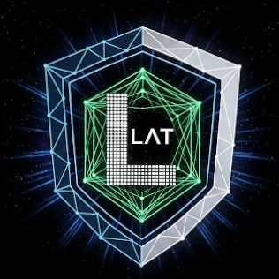

#  LATTICE ($LAT)

VERA Protocol provides a post-quantum signature layer for EVM application workflows, adding ML-DSA-87-based protocol signatures and on-chain state anchoring without replacing standard wallet authorization, with a long-term vision for decentralized verification.

### 🌐 Official Links
- **Website:** [https://lattice-labs-base.github.io/lattice/](https://lattice-labs-base.github.io/lattice/)
- **Telegram:** t.me/Lattice_LAT
- **BaseScan (Mainnet Asset Layer):** [https://basescan.org/token/0x0a320C8daC9fB56C7FC766CDF2c6068949fa4B74](https://basescan.org/token/0x0a320C8daC9fB56C7FC766CDF2c6068949fa4B74)
- **Live Terminal DApp:** [https://vera-sdk-mainnet.vercel.app/](https://vera-sdk-mainnet.vercel.app/)
- **SDK JavaScript Distribution:** [https://vera-sdk-mainnet.vercel.app/vera-pqc-sdk.js](https://vera-sdk-mainnet.vercel.app/vera-pqc-sdk.js)

### 📊 Project Status
- **Current Core Phase:** Phase 4: Production Mainnet Deployment & Commercial Transition
- **Asset Settlement:** Base Mainnet ($LAT Token Layer)
- **Verification Engine:** Go-based ML-DSA-87 Engine (Render Microservice)
- **Blockchain Anchor:** Base Mainnet
- **EVM Expansion:** Multi-Chain Architecture Designed
- **Security & Integrity:** Protocol-Signed Post-Quantum Proof Anchoring Architecture
- **LAT Token Contract:** `0x0a320C8daC9fB56C7FC766CDF2c6068949fa4B74`
- **VERA Anchor Contract (Base Mainnet V5):** `0x34233747E842082fCfeAC2f248159EcB4a6c6f04`

---

### 🏗️ System Architecture

<pre><code>  [ Web3 Wallet / External DApp ]
                 │
                 ▼
  [ VERA PQC Client SDK / Terminal ]
                 │
                 ▼
     [ Vercel Routing Layer ]
                 │
                 ▼
   [ Go PQC Engine (Render Node) ]
   (ML-DSA-87 / NIST FIPS 204 Protocol Signer)
                 │
                 ▼
   [ Base Mainnet Anchor Contract ]
  (0x3423...6f04 / commitProof)</code></pre>

---

### 🚀 VERA Terminal & Client Integration

VERA Protocol provides both a live interactive terminal and a simple JavaScript SDK (`vera-pqc-sdk.js`) for Web3 application developers to integrate post-quantum protocol signatures and anchoring into EVM workflows.

#### ⚡ 1. Simple JavaScript SDK Integration
Developers can integrate post-quantum protocol signing and Base Mainnet anchoring directly into their HTML/JS application:

<pre><code>&lt;!-- Ethers.js Dependency --&gt;
&lt;script src="https://cdnjs.cloudflare.com/ajax/libs/ethers/5.7.2/ethers.umd.min.js"&gt;&lt;/script&gt;

&lt;!-- VERA PQC SDK --&gt;
&lt;script src="https://vera-sdk-mainnet.vercel.app/vera-pqc-sdk.js"&gt;&lt;/script&gt;

&lt;script&gt;
  // Initialize SDK
  const vera = new VeraSDK();

  async function runPQC() {
    try {
      // Step 1: Connect, generate ML-DSA-87 protocol signature, and commit anchor to Base Mainnet
      const result = await vera.anchor(window.ethereum);
      
      console.log("Transaction Hash:", result.transactionHash);
      console.log("BaseScan URL:", result.scanUrl);
    } catch (error) {
      console.error("PQC Anchoring Failed:", error);
    }
  }
&lt;/script&gt;</code></pre>

#### 🖥️ 2. Sandbox Terminal
- **Live Terminal DApp:** https://vera-sdk-mainnet.vercel.app/
- **Official Portal:** https://lattice-labs-base.github.io/lattice/

---

### 🛡️ Core Architecture & Technical Workflow

The VERA Protocol utilizes a dual-key routing topology that decouples standard ledger authorization from quantum-safe proof anchoring, enforcing an "Extend, not Replace" integration paradigm:

1. **Identity & Connectivity (CONNECT)**: Intercepts Web3 provider payloads and verifies network alignment with target EVM L2 environments (Base Mainnet Chain ID: `0x2105` / `8453`).
2. **Lattice Payload Computation (SECURE)**: The high-performance Go backend executes ML-DSA-87 protocol signature generation in accordance with NIST FIPS 204 post-quantum standards.
   - **Protocol Key Management**: VERA currently uses a protocol-managed ML-DSA-87 key pair within its Go-based backend. The protocol signing key is separate from users’ standard Web3 wallet keys and is used to generate protocol-level post-quantum signatures. This mechanism does not replace the user’s wallet authorization or independently make the underlying EVM transaction quantum-resistant.
3. **On-Chain State Anchoring (ANCHOR)**: Commits the generated proof state hash to the `VERA_Protocol_V5_0` contract through `commitProof`. The on-chain record provides a tamper-evident reference that can be used for subsequent off-chain integrity checks against the corresponding signed data with low-cost L2 transaction execution.
4. **EVM Multi-Chain Readiness**: The modular EVM architecture is designed to support future deployment across compatible Layer 2 networks (such as Arbitrum), while maintaining a consistent integration interface. Each target network requires independent deployment and verification.

---

### 🪙 Ecosystem & $LAT Economic Model

The **$LAT token** (`0x0a320C8daC9fB56C7FC766CDF2c6068949fa4B74`) is the ecosystem token associated with the Lattice project, intended to support future ecosystem coordination, governance, and network participation.

#### 🔑 Progressive Integration Strategy
- **Phase 1 (Current): Open Developer Onboarding**: VERA currently provides open verification access so developers can seamlessly integrate and test post-quantum security without initial token friction.
- **Phase 2 (Planned): Commercialization & Revenue Generation**: VERA will introduce tiered commercial API models, usage-based verification fees for high-volume dApps, and enterprise SLA support.

#### 🎯 Core $LAT Value Capture & Revenue Allocation
1. **Systematic Revenue Reinvestment (Planned)**:
   - Protocol revenues generated through commercial VERA offerings—after operational infrastructure costs—will be **systematically reinvested back into the ecosystem**.
   - Allocation priorities include deepening $LAT market liquidity pools, supporting developer onboarding grants, and driving continuous protocol R&D.
2. **Community Governance (Planned)**:
   - Future governance mechanisms may allow $LAT holders to participate in ecosystem proposals, treasury allocation discussions, developer grant programs, and protocol development priorities.
3. **Future Revenue-Linked LAT Mechanisms (Planned Evaluation)**:
   - As VERA transitions toward commercial operation, Lattice Labs will evaluate mechanisms for connecting ecosystem growth with the long-term economic role of $LAT.
   - Potential mechanisms include market liquidity reinforcement, $LAT buyback and burn models, and incentives for future decentralized verifier node participation.

---

### 🗺️ Strategic Roadmap & Milestones

#### 🟩 Phase 1: Research & Architecture ✔ Completed
- Mathematical design and system architecture of EVM-compatible lattice-based cryptography.

#### 🟦 Phase 2: VERA Sandbox & Testnet Anchoring ✔ Completed
- Successful execution of testnet Proof of Concept (PoC) on Base Sepolia.
- Deployment and testing of internal Go-based proof computation microservices.

#### 🟨 Phase 3: PQC SDK & Mainnet Foundation ✔ Completed
- Deployment of the Go-based ML-DSA-87 computation microservice supporting NIST FIPS 204.
- Release of `vera-pqc-sdk.js` and live Base Mainnet anchor contract deployment (`0x3423...6f04`).

#### 🟥 Phase 4: Mainnet Ecosystem Adoption & Commercial Transition (Active)
- **✔ Completed:** Live End-to-End production pipeline (Vercel DApp ⇔ Render Go Engine ⇔ Base Mainnet EVM).
- **In Progress:** Onboarding Base ecosystem dApps through the free developer verification tier.
- **Planned:** Expanding VERA verification contracts across compatible EVM L2 nodes (e.g., Arbitrum).
- **Planned:** Rollout of commercial API subscription tiers and execution of the $LAT Revenue Reinvestment Program.

---

### ⚙️ Smart Contract Reference (Base Mainnet)

- **Network:** Base Mainnet (Chain ID: `8453` / `0x2105`)
- **Contract Address:** [`0x34233747E842082fCfeAC2f248159EcB4a6c6f04`](https://basescan.org/address/0x34233747E842082fCfeAC2f248159EcB4a6c6f04)
- **Core Interface:** `commitProof(string requestId, address userAddress, string proofHash, string polyMapping)`

---
© 2026 Lattice Labs. All rights reserved. Selected implementation details remain proprietary.
